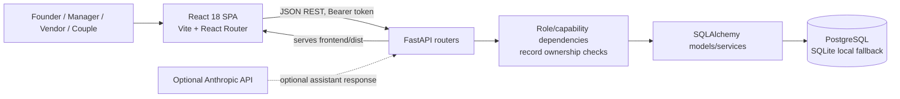
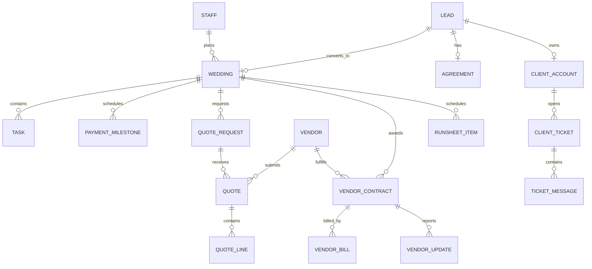

# The Royal Knot

**Wedding Planning Management System** - a role-based operations platform for a wedding planning agency, from first enquiry through planning, event-day coordination, vendor settlement, and season reporting.

    

> Documentation is based on the supplied repository snapshot. A deployed URL, demo video, project author, and the referenced project PDF were not supplied. Production readiness has not been established; see [known gaps](#known-gaps-and-deployment-notes).

## Contents

- [Overview](#overview)
- [Documentation package](#documentation-package)
- [Problem and objectives](#problem-and-objectives)
- [Implemented areas](#implemented-areas)
- [Screenshots](#screenshots)
- [Architecture](#architecture)
- [Technology](#technology)
- [Repository layout](#repository-layout)
- [Run locally](#run-locally)
- [Application flow](#application-flow)
- [API reference](#api-reference)
- [Data model](#data-model)
- [Authentication and security](#authentication-and-security)
- [Verification](#verification)
- [Known gaps and deployment notes](#known-gaps-and-deployment-notes)
- [Future work](#future-work)
- [Acknowledgements](#acknowledgements)

## Documentation package

- [Extended technical documentation](docs/project-documentation.md) - source audit, vendor API contract, all router groups, data model, security and setup caveats.
- [Project analysis](PROJECT_ANALYSIS.md) - concise implementation and gap assessment.
- [Documentation report](DOCUMENTATION_REPORT.md) - deliverables, validation scope and known limits.
- [Architecture diagrams](docs/architecture/) - Mermaid architecture, workflow, data-flow and ER sources.
- [PDF documentation](PROJECT_DOCUMENTATION.pdf) - formatted five-page overview of architecture, workflows, data model, vendor endpoints and operational findings.

## Overview

Royal Knot brings agency staff, wedding vendors, and couples into one system organized around a shared wedding record. Leads, agreements, task plans, quote comparisons, event schedules, payments, vendor updates, and reporting are linked instead of being maintained in separate chat threads and spreadsheets.

The repository contains a React single-page application and a FastAPI API. SQLAlchemy maps the domain to PostgreSQL for production; the backend also has a SQLite fallback for local development. In deployment, FastAPI serves the built React bundle from the same origin.

### Intended users

| User | Main workspace |
| --- | --- |
| Founder | Season metrics, staff and wedding assignment, vendor scorecards, financial reporting, and shared reports |
| Manager | Assigned weddings, planning tasks, quotes, day-of schedule, client requests, and payments |
| Vendor | Quote requests, contracted jobs, progress updates, availability, earnings, and profile/capacity |
| Couple | Wedding journey, checklist, payments, vendors, event schedule, invitations, agreement, and help requests |

## Problem and objectives

The project addresses fragmented wedding operations: enquiries can be missed, vendor quotes arrive in different formats, recurring checklists are copied by hand, event updates are chased over messaging apps, and agency profitability is difficult to calculate from scattered records.

The implementation aims to:

- Keep one linked wedding record as the operational source for planning, vendors, money, and event-day work.
- Separate founder, manager, vendor, and couple workspaces.
- Scope managers to assigned weddings and vendors/couples to their own records in backend handlers.
- Normalize vendor quotes so managers can compare scope and landed cost.
- Generate planning tasks and payment milestones from wedding conversion.
- Track event-day progress and vendor check-ins.
- Derive billing, vendor settlement, and per-wedding profitability from stored records.

## Implemented areas

| Area | Implemented behavior in this repository |
| --- | --- |
| Enquiries and agreements | Capture public enquiries; manage leads; create client accounts and agreements; record a signed agreement in the authenticated couple portal; convert a lead into a wedding |
| Wedding planning | Create/edit weddings; assign managers; generate a task plan and milestones; manage tasks and client-facing checklist |
| Vendor procurement | Create request-for-quotes, collect quote lines, compare normalized quotes, award a vendor, close other quotes, and create a vendor contract |
| Event operations | Run sheet, status transitions, check-in action, live-day overview, and derived lateness view for staff |
| Vendor portal | Vendor overview; request details and quote submission/decline; jobs and progress updates; calendar availability; earnings; profile and capacity |
| Couple portal | Journey overview, checklist, payment milestones and payment reports, vendor list, schedule, invitation editor, agreement signing, support tickets, and profile |
| Settlement and reporting | Vendor bills, three-way match, pay actions, change orders, headcount reconciliation, time logs, P&L, analytics, and revocable share links |
| Assistant | Founder/manager assistant that answers from project records; an Anthropic API key is optional for generated responses |

### Vendor portal scope and gaps

The vendor portal is present in `frontend/src/pages/vendor/` and `/api/vendor-portal`. Vendors can see requests and contracted jobs, submit or decline prices, report job progress, maintain availability and capacity, review aggregated earnings, and update their own profile. The supplied code does **not** include a dedicated vendor arrival-check-in screen/route, a vendor task-status endpoint, or a vendor notification feed. Run-sheet check-in is available in the staff operations API. Earnings are summarized by contract/job; there is no vendor-facing invoice ledger endpoint in this portal.

## Screenshots

No screenshots are included. The prompt mentioned a reference PDF, but no PDF was present in the supplied files. I did not substitute screenshots from another application or fabricate UI images. The available application could not be opened in the documentation browser with the isolated local database instance, so the screenshot capture requirement remains outstanding. See [`docs/screenshots/README.md`](docs/screenshots/README.md) and [`DOCUMENTATION_REPORT.md`](DOCUMENTATION_REPORT.md).

## Architecture



FastAPI mounts the routers and serves `frontend/dist` when that directory exists. During development, Vite serves the SPA on port 5173 and proxies `/api` to the backend on port 8000. Mermaid sources are in [`docs/architecture/`](docs/architecture/).

## Technology

| Layer | Technology | Evidence / use |
| --- | --- | --- |
| Frontend | React 18, JavaScript, Vite, React Router 6 | `frontend/package.json`, `frontend/src/App.jsx` |
| UI and charts | Tailwind CSS 3, Recharts | `frontend/tailwind.config.js`, page components |
| Fonts | Cinzel, Cormorant Garamond, Great Vibes | `@fontsource/*` packages |
| Backend | Python 3.10+, FastAPI, Uvicorn, Pydantic 2 | `backend/requirements.txt`, `backend/app/main.py` |
| ORM / database | SQLAlchemy 2, PostgreSQL via psycopg; SQLite fallback | `backend/app/db.py`, `backend/app/models.py` |
| Authentication | HMAC-signed bearer tokens and PBKDF2 password hashes | `backend/app/services/auth.py`, `frontend/src/api.js` |
| Optional assistant | Anthropic Messages API when `ANTHROPIC_API_KEY` is set | `backend/app/services/assistant.py` |
| Deployment configuration | Render Docker service declaration | `render.yaml` (currently references a missing `Dockerfile`) |

## Repository layout

```text
royal-knot/
├── .env.example                 Safe configuration template
├── .gitignore                   Ignores .env files, node_modules and build output
├── README.md                    Project and setup documentation
├── DEMO.md                      Demo story, sample account list and walkthrough
├── render.yaml                  Render service configuration
├── run.sh                       Install/build/start script
├── backend/
│   ├── app/main.py              FastAPI setup, router mounts, startup and SPA serving
│   ├── app/db.py                SQLAlchemy engine/session and local .env loading
│   ├── app/models.py            22 mapped database tables
│   ├── app/schemas.py           Pydantic request validation models
│   ├── app/migrate.py           Additive schema compatibility and role normalization
│   ├── app/routers/             REST route groups
│   ├── app/services/            Auth, planning, quotes, finance, run sheet and vendor logic
│   ├── app/seed.py              Opt-in demo data
│   ├── create_schema.py         Create/validate schema without demo records
│   ├── reset_database.py        Destructive reset utility - inspect before use
│   ├── requirements.txt         Python dependencies
│   └── verify.py                Custom integration verification script
└── frontend/
    ├── package.json             Frontend scripts and dependencies
    ├── vite.config.js           Port 5173 and /api proxy to port 8000
    ├── public/auth/             Portal background images
    ├── src/App.jsx              Portal routing and app shell selection
    ├── src/auth.jsx             Auth context and capability constants
    ├── src/api.js               Bearer-token API client and formatting helpers
    ├── src/components/          Shared UI, forms, agreements and signatures
    └── src/pages/               Founder, manager, vendor, couple and public pages
```

The supplied snapshot also contains `frontend/dist/`, a built frontend bundle. `node_modules/` is not required in the repository and is ignored by `.gitignore`.

## Run locally

### Prerequisites

- Python 3.10 or newer.
- Node.js compatible with Vite 6 and npm.
- PostgreSQL for persistent local data. Without `DATABASE_URL`, the backend falls back to a local SQLite file.

### Configure environment

From the repository root:

```bash
cp .env.example .env
```

Edit `.env` with a local PostgreSQL URL, a long random `SECRET_KEY`, and (for a new empty database) founder bootstrap details. Do not commit `.env`. The `.env.example` file uses placeholders; actual `.env` values are intentionally not documented here.

Important settings:

| Variable | Purpose |
| --- | --- |
| `DATABASE_URL` | PostgreSQL connection URL; omitted value falls back to `sqlite:///./royalknot.db` |
| `SECRET_KEY` | HMAC token-signing secret; set a unique strong value before deployment |
| `SEED_ON_START` | `0` keeps operational data empty; `1` loads the demo season on startup |
| `BOOTSTRAP_FOUNDER_NAME`, `BOOTSTRAP_FOUNDER_EMAIL`, `BOOTSTRAP_FOUNDER_PASSWORD` | Creates the first founder account when all are supplied and the account does not exist |
| `ANTHROPIC_API_KEY`, `ASSISTANT_MODEL` | Optional assistant generation configuration |
| `DATABASE_ECHO` | Optional SQLAlchemy SQL logging switch |
| `PORT` | Port used by `run.sh`; defaults to 8000 |

### One-command local run

On macOS/Linux or a shell with Bash:

```bash
./run.sh
```

The script installs backend dependencies, runs `npm install` and `npm run build` in `frontend/`, then starts Uvicorn. Open `http://localhost:8000`. Demo seeding is **not** enabled by the script itself; the default is empty (`SEED_ON_START=0`). For the demo walkthrough, set `SEED_ON_START=1` in a disposable local database before starting.

### Separate development servers (hot reload)

Terminal 1 - API:

```bash
cd backend
python -m venv .venv
source .venv/bin/activate        # Windows: .venv\Scripts\Activate.ps1
pip install -r requirements.txt
python -m uvicorn app.main:app --reload --port 8000
```

Terminal 2 - Vite:

```bash
cd frontend
npm ci
npm run dev
```

Open `http://localhost:5173`. `frontend/vite.config.js` proxies `/api` to `http://localhost:8000`.

### Schema and demo data

The API startup calls SQLAlchemy `create_all`, then runs the repository's additive compatibility migration and role normalization. To create/validate tables without seeding, run from the repository root:

```bash
python backend/create_schema.py
```

For a demo-only database, set `SEED_ON_START=1` and start the app. The demo accounts and walkthrough are documented in [`DEMO.md`](DEMO.md). Never enable demo seeding against a production database.

### Deployment status

`render.yaml` defines a Docker service with `/api/health` as the health check, but this supplied snapshot has no root `Dockerfile`. The documented `docker build` and current Render configuration therefore cannot be treated as runnable until a Dockerfile is added or the deployment configuration is changed. The optional Render PostgreSQL database is commented out; persistent data requires a configured database.

## Application flow

```mermaid
sequenceDiagram
  participant C as Couple
  participant F as Founder/Manager
  participant V as Vendor
  participant A as API
  participant D as Database
  C->>A: Submit enquiry
  A->>D: Save lead and select owner
  F->>A: Send agreement / convert after signature
  A->>D: Create wedding, tasks and milestones
  F->>A: Send quote request
  V->>A: Submit normalized quote
  A->>D: Save quote lines
  F->>A: Award quote
  A->>D: Close losing quotes; create vendor contract
  V->>A: Post progress / availability / cost
  A->>D: Scope updates to authenticated vendor
  F->>A: Run event operations and settle vendor bills
  A->>D: Store operational and settlement records
```

## API reference

The backend exposes interactive OpenAPI documentation at `/docs` and `/openapi.json` when running. The verified router catalog, vendor request schemas, and route-level access notes are in [`docs/project-documentation.md`](docs/project-documentation.md). Key route groups:

| Prefix | Purpose | Access |
| --- | --- | --- |
| `/api/auth` | Login, demo login, account roles and password changes | Login and roles are public; `demo-login` is also public in source |
| `/api/vendor-portal` | Vendor identity, overview, requests, jobs, updates, earnings, availability | Vendor bearer token; handlers resolve the vendor from the token |
| `/api/client` | Authenticated couple workspace | Couple bearer token and current-client scoping |
| `/api/enquire` | Public enquiry intake | Public |
| `/api/leads`, `/api/weddings`, `/api/rfqs`, `/api/bills` | Agency workflow modules | Staff token plus capability dependencies as mounted in `main.py` |
| `/api/runsheet`, `/api/analytics`, `/api/share-links` | Event operations, analytics and private share management | Capability-gated; public read-only share uses `/api/shared/{token}` |
| `/api/profile` | Current signed-in user's profile and avatar | Current authenticated account |
| `/api/health` | Service/database readiness | Public health response |

## Data model

There are 22 SQLAlchemy tables in `backend/app/models.py`. The central relationships are shown below; the complete table inventory and key foreign keys are in [`docs/architecture/database-er.mmd`](docs/architecture/database-er.mmd).



## Authentication and security

- The frontend stores the bearer token in `localStorage` under `rk.token` and attaches it as an `Authorization: Bearer` header.
- The backend uses HMAC-signed tokens and PBKDF2-HMAC-SHA256 password hashes.
- Capability dependencies are mounted in `backend/app/main.py`; vendor and client routers use their own current-account dependencies. Vendor helper lookups scope quotes/contracts to the current vendor.
- Request bodies use Pydantic schemas with type, length, range, and allowed-value validation in key workflows.
- PostgreSQL credentials and signing keys stay in backend environment configuration; the React bundle does not consume database credentials.

Security caveats found in the supplied code:

1. `/api/auth/demo-login` is public and returns a token for a staff/vendor/client account selected by database ID. Source comments say to remove it before a real deployment, but the route is not guarded by `SEED_ON_START`. Disable or remove it before exposing this service.
2. `auth.py` has a built-in development signing-secret fallback. Configure `SECRET_KEY` in every deployment and fail startup if it is absent in production.
3. CORS is configured with wildcard origins and credentials. Review and restrict this policy before using cross-origin deployments.
4. `DEMO.md` documents a shared demo password. Keep demo accounts and demo data out of production.

## Verification

- `backend/verify.py` is a custom end-to-end verification script. The existing README describes 183 checks; it was not run during this documentation pass.
- The frontend has `dev`, `build`, and `preview` scripts but no frontend test script in `frontend/package.json`.
- No separate unit-test framework or test suite was found in the supplied tree.
- Documentation checks were limited to source inspection. API tests, a frontend production build, and screenshot capture were not performed.

## Known gaps and deployment notes

- The requested PDF reference was not present among the supplied files.
- No actual screenshots were supplied, and application screenshots could not be captured in this environment.
- The repository has no `Dockerfile`, despite `render.yaml` and the old README instructing Docker deployment.
- The `.env` file exists in the supplied local copy and is ignored by `.gitignore`. Its values were not copied into documentation.
- Vendor tasks/status, arrival check-in, notification feed, and a detailed vendor invoice history are not implemented as vendor-facing features in this code snapshot.
- `render.yaml` sets `SEED_ON_START=0` and comments out the database resource, so it does not provide durable PostgreSQL storage as supplied.
- Live demo URL, demo video, and author identity remain unspecified.

## Future work

- Remove or gate demo-login, require a configured production signing secret, and narrow CORS origins.
- Add a Dockerfile or replace the Render Docker runtime with a verified build/start configuration.
- Add the missing vendor task, arrival check-in, notification, and invoice-history workflows if required by the product brief.
- Add automated frontend and API tests, a repeatable local test database, and CI build checks.
- Capture real screenshots from a sanitized seeded development database and add them under `docs/screenshots/`.

## Acknowledgements

The existing README states that the project was built for the Odoo Hackathon. No verified author or contributor names were supplied.
